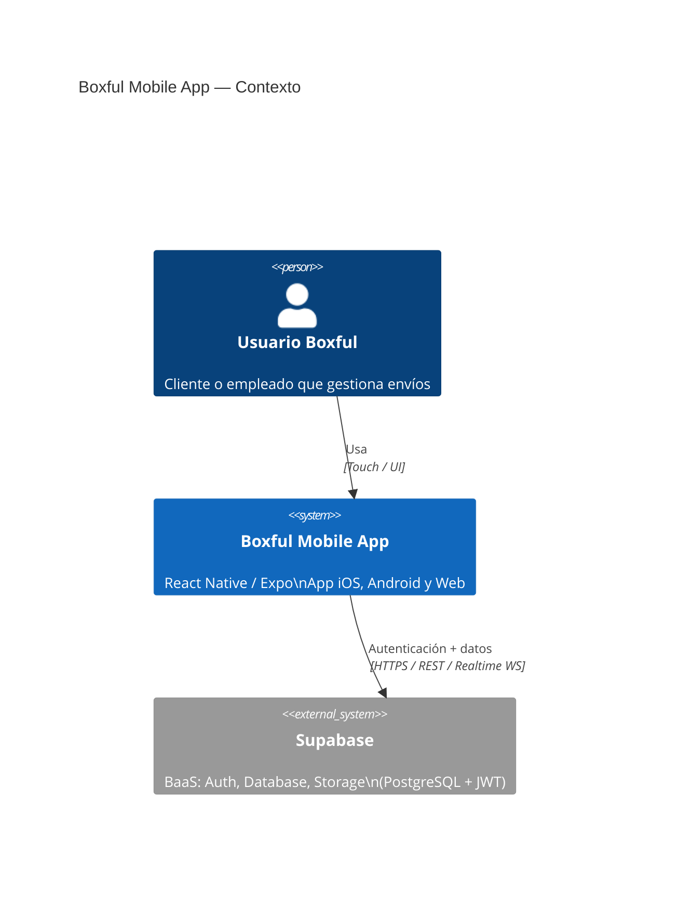
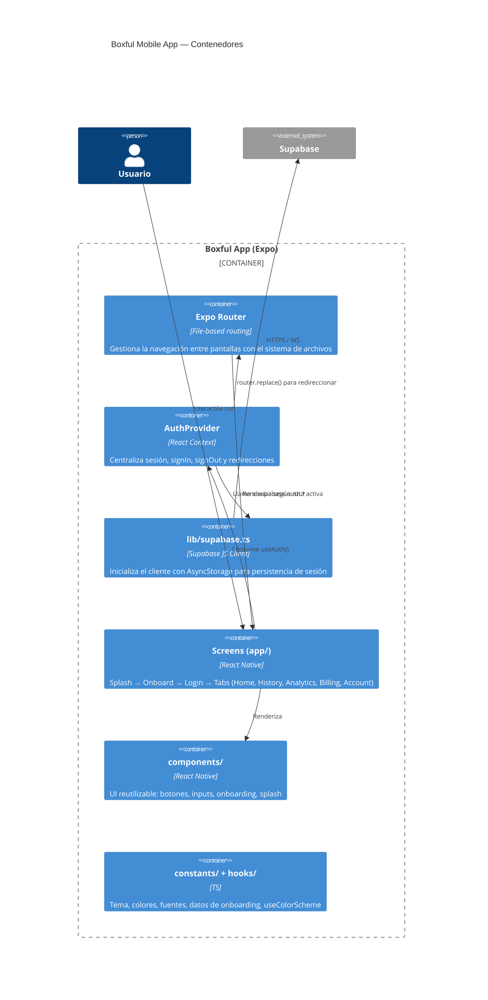
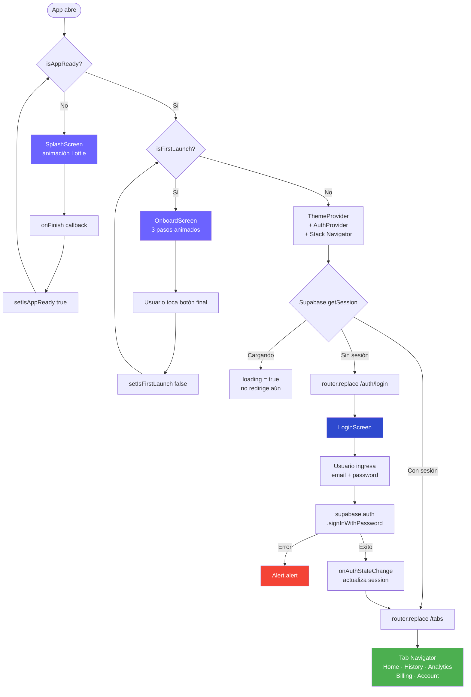
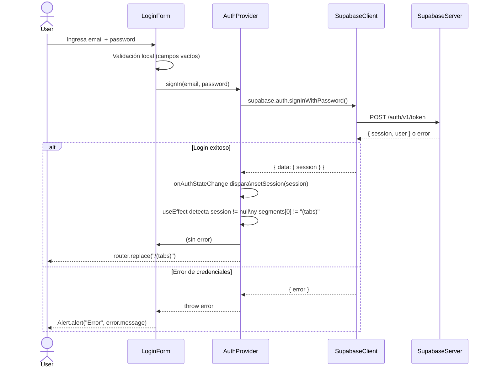
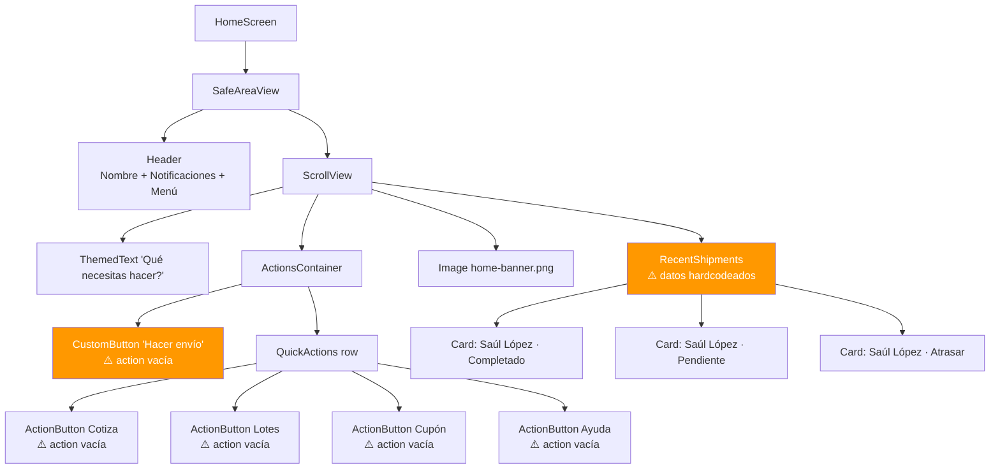

# Revisión Arquitectónica — Boxful Mobile App

> Stack: React Native · Expo Router · Supabase · TypeScript  
> Fecha de revisión: Mayo 2026

---

## Resumen ejecutivo

- ✅ **Lo que está bien:** Routing file-based con Expo Router bien organizado, AuthProvider centraliza toda la lógica de sesión, TypeScript en todo el proyecto.
- ⚠️ **Lo que preocupa:** `isFirstLaunch` no persiste entre sesiones (siempre muestra onboarding al reabrir), hardcoded data en pantallas, colores duplicados entre `theme.ts` y los componentes.
- 🎯 **Lo que haría primero:** Persistir el flag de onboarding en AsyncStorage y crear una capa de servicios que abstraiga las llamadas a Supabase.

---

## Contexto

App móvil de logística para la empresa **Boxful** (envíos y paquetería). Construida con Expo SDK 54, React Native 0.81 y expo-router para la navegación file-based. El backend de autenticación y datos es **Supabase**. La app corre en iOS, Android y Web.

Pantallas implementadas actualmente:
- Splash animada (Lottie)
- Onboarding (3 pasos con animaciones Reanimated)
- Login (email/password vía Supabase Auth)
- Home dashboard con envíos recientes (datos mockeados)
- Historial, Analíticas, Facturación, Cuenta (stubs vacíos)

---

## Diagrama C4 — Nivel 1: Contexto del sistema



---

## Diagrama C4 — Nivel 2: Contenedores internos



---

## Flujo de arranque de la app

Este es el flujo más crítico: determina qué ve el usuario al abrir la app desde cero.



---

## Flujo de autenticación (detalle)



---

## Árbol de navegación (Expo Router)

```mermaid
graph TD
    Entry["expo-router/entry"] --> RootLayout["app/_layout.tsx\nRootLayout"]

    RootLayout -->|isAppReady=false| Splash["SplashScreen\nLottie"]
    RootLayout -->|isFirstLaunch=true| Onboard["app/onboard/index.tsx\nOnboardScreen"]
    RootLayout -->|ready + launched| Stack["Stack Navigator"]

    Stack --> Index["app/index.tsx\n→ LoginScreen"]
    Stack --> AuthLogin["app/auth/login/index.tsx\nLoginScreen"]
    Stack --> Tabs["app/(tabs)/_layout.tsx\nTab Navigator"]
    Stack --> Modal["app/modal.tsx"]

    Tabs --> Home["(tabs)/index.tsx\nHomeScreen"]
    Tabs --> History["(tabs)/history.tsx\nHistoryScreen ⚠️ stub"]
    Tabs --> Analytic["(tabs)/analytic.tsx\nAnalyticScreen ⚠️ stub"]
    Tabs --> Billing["(tabs)/billing.tsx\nBillingsScreen ⚠️ stub"]
    Tabs --> Account["(tabs)/account.tsx\nAccountScreen"]

    AuthProvider["AuthProvider\n(redirección dinámica)"] -.->|no session → /auth/login| AuthLogin
    AuthProvider -.->|session → /(tabs)| Tabs

    style Splash fill:#6C63FF,color:#fff
    style Onboard fill:#6C63FF,color:#fff
    style AuthLogin fill:#2E49CE,color:#fff
    style Tabs fill:#4CAF50,color:#fff
    style History fill:#FF9800,color:#fff
    style Analytic fill:#FF9800,color:#fff
    style Billing fill:#FF9800,color:#fff
```

---

## Estructura de componentes — HomeScreen



---

## Fortalezas

**1. File-based routing bien estructurado.** Expo Router con el patrón `(tabs)` es idiomático y escala bien. Agregar nuevas pantallas al tab bar es añadir un archivo.

**2. AuthProvider correcto como contrato.** El contexto expone exactamente lo necesario: `session`, `loading`, `signIn`, `signOut`. Cualquier pantalla consume `useAuth()` sin conocer Supabase directamente.

**3. Persistencia de sesión configurada.** `AsyncStorage` como storage de Supabase garantiza que el usuario no tenga que re-loguearse al reabrir la app.

**4. Animaciones con Reanimated.** El uso de `useSharedValue` y `useAnimatedStyle` en el onboarding es la forma correcta y performante de animar en el UI thread.

**5. TypeScript consistente.** Tipado en toda la base de código, incluyendo el contexto de Auth y las props de componentes.

---

## Hallazgos principales

### 🔴 1. `isFirstLaunch` no persiste — el onboarding aparece siempre

**Observación:** En `_layout.tsx`, `isFirstLaunch` se inicializa como `useState(true)`. Cada vez que la app arranca desde frío, el usuario verá el onboarding de nuevo.

**Por qué importa:** Experiencia de usuario rota. Un usuario que ya completó el onboarding ayer lo verá cada vez que abra la app.

**Recomendación:** Persistir el flag con AsyncStorage.

```typescript
// En _layout.tsx
const [isFirstLaunch, setIsFirstLaunch] = useState<boolean | null>(null);

useEffect(() => {
  AsyncStorage.getItem('hasLaunched').then((value) => {
    setIsFirstLaunch(value === null); // null = nunca ha lanzado
  });
}, []);

const handleOnboardFinish = async () => {
  await AsyncStorage.setItem('hasLaunched', 'true');
  setIsFirstLaunch(false);
};
```

**Impacto:** Alto · **Esfuerzo:** Bajo → **Hacer ya**

---

### 🟡 2. Datos hardcodeados en HomeScreen

**Observación:** `recentShipments` en `(tabs)/index.tsx` es un array local con datos ficticios. Los botones de acción tienen `action={() => {}}`.

**Por qué importa:** La pantalla principal no refleja datos reales del usuario, y los CTAs principales no hacen nada.

**Recomendación:** Crear un hook `useShipments()` que llame a Supabase y devuelva los envíos reales. Los botones de acción deben conectarse a sus rutas correspondientes.

**Impacto:** Alto · **Esfuerzo:** Medio → **Próximo sprint**

---

### 🟡 3. Pantallas stub sin implementar

**Observación:** `history.tsx`, `analytic.tsx` y `billing.tsx` son pantallas vacías con texto placeholder.

**Por qué importa:** El tab bar completo está visible pero 3 de 5 secciones no funcionan. Si esto llega a usuarios reales, es confuso.

**Recomendación:** Si no están listas, ocultarlas del tab bar con `href: null` hasta estar implementadas, o mostrar un estado "Próximamente".

**Impacto:** Medio · **Esfuerzo:** Bajo → **Hacer ya**

---

### 🟡 4. Colores duplicados y sin sistema coherente

**Observación:** `constants/theme.ts` define `Colors` con `tintColorLight: '#0a7ea4'`, pero los componentes usan colores hardcodeados completamente distintos (`#2E49CE`, `#FF6139`, `#141F58`). Son dos sistemas de colores desconectados.

**Por qué importa:** Cambiar la paleta de marca implica buscar y reemplazar colores en N archivos. Riesgo de inconsistencia visual.

**Recomendación:** Unificar. Actualizar `theme.ts` con los colores reales de Boxful y usar siempre `Colors.primary`, `Colors.accent`, etc. en los componentes.

**Impacto:** Medio · **Esfuerzo:** Bajo → **Hacer en los próximos días**

---

### 🟢 5. Sin capa de servicios / data access layer

**Observación:** Las llamadas a `supabase.auth.*` están directamente en `AuthProvider`. Cuando se agreguen consultas de datos (envíos, facturas, etc.), esas llamadas probablemente irán directo en los componentes.

**Por qué importa:** Dificulta testear, y si migran de Supabase o cambian la API, hay que buscar en todos los componentes.

**Recomendación:** Crear una carpeta `services/` o `api/` con funciones puras que encapsulen las llamadas a Supabase:

```
services/
  auth.service.ts     → signIn, signOut, getSession
  shipments.service.ts → getShipments, createShipment
  billing.service.ts  → getInvoices
```

**Impacto:** Medio · **Esfuerzo:** Medio → **Próximo trimestre** (cuando se implementen las pantallas stub)

---

## Priorización

| Prioridad | Acción | Impacto | Esfuerzo |
|-----------|--------|---------|----------|
| 1 🔴 | Persistir `isFirstLaunch` con AsyncStorage | Alto | Bajo |
| 2 🟡 | Ocultar/placeholders en tabs vacíos | Medio | Bajo |
| 3 🟡 | Unificar sistema de colores en `theme.ts` | Medio | Bajo |
| 4 🟡 | Conectar HomeScreen a datos reales de Supabase | Alto | Medio |
| 5 🟢 | Crear capa `services/` para abstraer Supabase | Medio | Medio |

---

## Roadmap sugerido

**Ahora (próximas 2 semanas)**
- Persistir flag de onboarding
- Limpiar tabs vacíos (ocultar o poner estado "Próximamente")
- Unificar `theme.ts` con los colores reales de la app

**Próximo trimestre**
- Implementar `services/shipments.ts` y conectar HomeScreen
- Implementar pantallas de Historial y Analíticas con datos reales
- Agregar manejo de errores global (en lugar de `Alert.alert` sueltos)

**Más adelante**
- Registro de cuenta (el botón existe pero no navega a ningún lado)
- Passkey login (implementado como `console.log`)
- Observabilidad: Sentry o similar para crashlytics en producción

---

## Preguntas abiertas

1. ¿Supabase tendrá tablas de envíos, facturas y analíticas, o hay otro backend REST?
2. ¿El registro de usuarios es por invitación o self-service?
3. ¿Se planea soporte web real o es principalmente mobile?
4. ¿Hay más de un rol de usuario (cliente vs. operador de almacén)?
