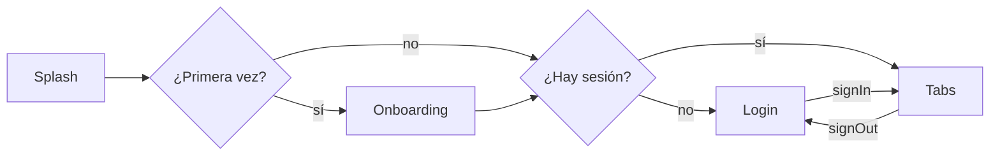

# Dashboard App · React Native

[](https://github.com/rodval/dashboard-react-native/actions/workflows/ci.yml)


App móvil de gestión de envíos para iOS, Android y Web: splash animada,
onboarding, inicio de sesión con Supabase y un dashboard con los envíos
recientes del usuario.

<!-- Agrega aquí capturas o un GIF del flujo:
<p align="center">
  
  
  
  
</p>
-->

## Funcionalidades

- **Splash animada** con Lottie.
- **Onboarding** de 3 pasos con animaciones de Reanimated (scroll paginado,
  indicadores animados). Se muestra solo la primera vez: el estado se guarda
  en AsyncStorage.
- **Autenticación** con email y contraseña vía Supabase Auth. La sesión
  persiste entre reinicios y se refresca sola.
- **Rutas protegidas:** un `AuthProvider` redirige a login o al dashboard
  según el estado de la sesión.
- **Dashboard** con acciones rápidas y tarjetas de envíos recientes.
- **Navegación por pestañas** (Inicio, Historial, Analíticas, Facturación,
  Cuenta) con feedback háptico.
- Soporte de **modo claro/oscuro** y **safe areas** en todas las plataformas.

## Stack

| Área          | Tecnología                                                   |
| ------------- | ------------------------------------------------------------ |
| Framework     | Expo SDK 58 · React Native 0.88 · React 19 (React Compiler)  |
| Navegación    | Expo Router (rutas por archivos, typed routes)               |
| Backend       | Supabase (Auth + sesión persistida en AsyncStorage)          |
| Animaciones   | React Native Reanimated · Lottie                             |
| Lenguaje      | TypeScript                                                   |
| Calidad       | Jest · React Native Testing Library · ESLint · GitHub Actions |

## Arquitectura



- `app/` — pantallas y layouts (Expo Router). `app/_layout.tsx` orquesta
  splash → onboarding → app.
- `providers/auth-provider.tsx` — contexto de sesión: `signIn`, `signOut`
  y redirecciones.
- `lib/supabase.ts` — cliente de Supabase configurado con AsyncStorage.
- `hooks/` — `useFirstLaunch`, tema y esquema de color.
- `components/` — UI reutilizable (botones, inputs, onboarding, splash).
- `constants/` — tema y datos de ejemplo.

En [ARCHITECTURE.md](ARCHITECTURE.md) está la revisión completa: diagramas
C4, flujo de autenticación, hallazgos priorizados y roadmap.

## Cómo correrlo

**Requisitos:** Node 22+ y un proyecto de [Supabase](https://supabase.com)
con un usuario creado en *Authentication → Users*.

1. Instala dependencias:

   ```bash
   npm install
   ```

2. Configura las variables de entorno:

   ```bash
   cp .env.example .env.local
   ```

   Completa `EXPO_PUBLIC_SUPABASE_URL` y `EXPO_PUBLIC_SUPABASE_KEY` con la
   URL y la *anon key* de tu proyecto (*Project Settings → API*).

3. Inicia la app:

   ```bash
   npx expo start
   ```

   Ábrela en un simulador iOS (`i`), un emulador Android (`a`), en el
   navegador (`w`) o escaneando el QR con
   [Expo Go](https://expo.dev/go).

## Scripts

| Comando             | Descripción                         |
| ------------------- | ----------------------------------- |
| `npm start`         | Servidor de desarrollo de Expo      |
| `npm run ios`       | Build nativo para iOS               |
| `npm run android`   | Build nativo para Android           |
| `npm run web`       | Versión web                         |
| `npm test`          | Tests con Jest                      |
| `npm run lint`      | ESLint                              |

## Tests

Los tests usan Jest (`jest-expo`) y React Native Testing Library:

- `providers/__tests__/auth-provider.test.tsx` — carga de sesión,
  suscripción, redirecciones, `signIn`/`signOut` y manejo de errores.
- `hooks/__tests__/use-first-launch.test.ts` — persistencia del onboarding.
- `__tests__/screens/home.test.tsx` — render del dashboard y safe areas.

Cada push y pull request corre lint, chequeo de tipos y tests en
GitHub Actions.

## Roadmap

- [x] Splash, onboarding y login
- [x] Persistir el onboarding visto
- [ ] Capa `services/` para abstraer Supabase
- [ ] Conectar el dashboard a datos reales
- [ ] Implementar Historial, Analíticas y Facturación
- [ ] Registro de cuenta y login con passkey
- [ ] Manejo global de errores y monitoreo (Sentry)
